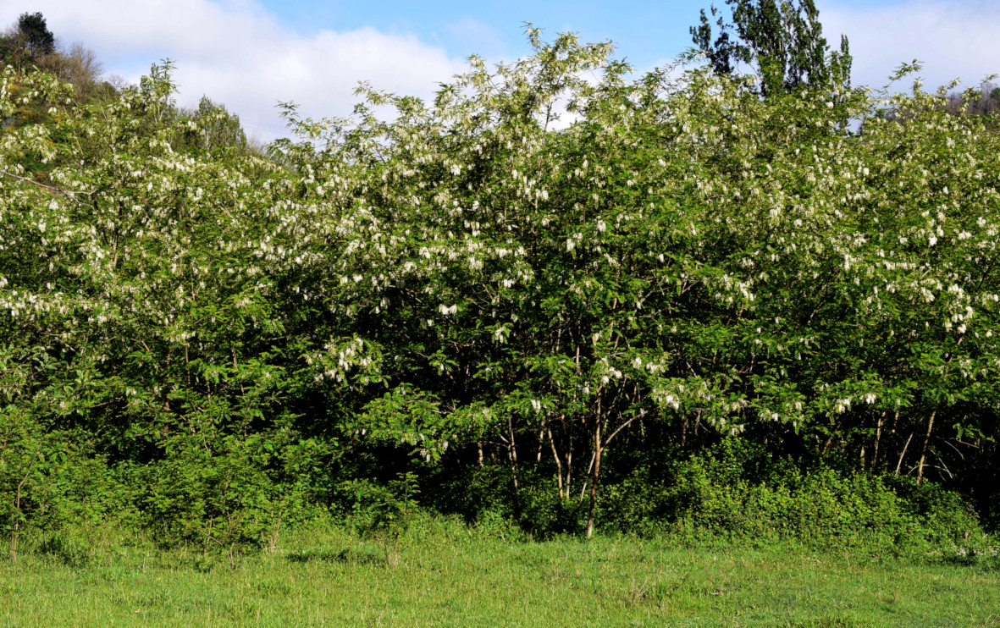

README.md
================

# Species pools of novel ecosystems: regional donor habitats and unrealized native diversity

This repository stores all the information related to the manuscript
*Species pools of novel ecosystems: regional donor habitats and unrealized native diversity*, including the
datasets, the scripts to perform data cleaning and analysis, and the
`Rmarkdown` files to create the manuscript.

## Contents

This repository is organised following the advice of [Wilson et
al. 2017](https://doi.org/10.1371/journal.pcbi.1005510) for recording
and storing research projects.

The following materials are available in the folders of this repository:

- `data` Data files.
- `src` Scripts in `R` language to perform the analyses and produce the
  figures of the manuscript.
- `results` Output of the `R` scripts, including figures and model
  outputs.
- `doc` Manuscript files.

## Citation

Please cite the repository, datasets and article as:

> (2026) Species pools of novel ecosystems: regional donor habitats and unrealized native diversity.
