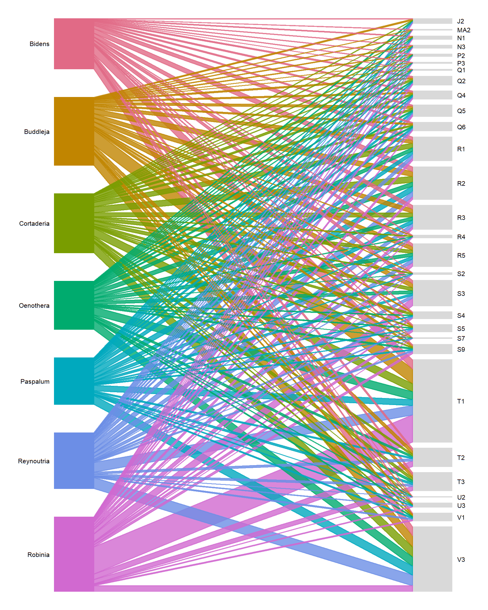

```{r setup, include=FALSE}
knitr::opts_chunk$set(echo = TRUE)
```

```{r message = FALSE, echo = FALSE, warning = FALSE}
knitr::knit_hooks$set(inline = function(x) {
  prettyNum(x, big.mark = ",")
})
library(tidyverse)
```

```{r figS2, out.width = "450px", echo = FALSE, fig.cap = "Regional donor habitats of the observed assemblages in the study habitats. Regional habitats are classified as EUNIS level 2, i.e., functional habitat types. Link width reflects the summed contribution of each donor habitat, allowing visualization of which regional habitats (on the left) act as the main sources for the observed assemblages in study habitats (on the right, colored by dominant non-native species). The meaning of EUNIS level 2 habitat codes can be consulted at https://floraveg.eu/habitat/"}

```

```{r tabS2, echo = FALSE}
tribble(
  ~Code, ~`EUNIS habitat (level 2)`, ~`Group in Fig. 3`,
  "J2",  "Low density buildings",                                         "Anthropogenic",
  "MA2", "Littoral biogenic habitats",                     "Not shown (marine)",
  "N1",  "Coastal dunes and sandy shores",                                "Not shown (coastal)",
  "N3",  "Rock cliffs, ledges and shores, including the supralittoral",                                "Not shown (coastal)",
  "P2",  "Running aquatic habitats",                                        "Not shown (inland waters)",
  "P3",  "Aquatic plant communities",                   "Not shown (inland waters)",
  "Q1",  "Raised and blanket bogs",                                       "Wetlands",
  "Q2",  "Valley mires, poor fens and transition mires",                  "Wetlands",
  "Q4",  "Base-rich fens and calcareous spring mires",                    "Wetlands",
  "Q5",  "Helophyte beds",                                                "Wetlands",
  "Q6",  "Periodically exposed shores",  "Wetlands",
  "R1",  "Dry grasslands",                                                "Grasslands",
  "R2",  "Mesic grasslands",                                              "Grasslands",
  "R3",  "Seasonally wet and wet grasslands",                             "Grasslands",
  "R4",  "Alpine and subalpine grasslands",                               "Grasslands",
  "R5",  "Woodland fringes and clearings and tall forb stands",           "Grasslands",
  "S2",  "Arctic, alpine and subalpine scrub",                            "Shrublands",
  "S3",  "Temperate and Mediterranean-montane scrub",                     "Shrublands",
  "S4",  "Temperate heathland",                                           "Shrublands",
  "S5",  "Maquis, arborescent matorral and thermo-Mediterranean scrub",   "Shrublands",
  "S7",  "Spiny Mediterranean heaths",                                    "Shrublands",
  "S9",  "Riverine and fen scrub",                                        "Shrublands",
  "T1",  "Broadleaved deciduous forests",                                  "Forests",
  "T2",  "Broadleaved evergreen forests",                                  "Forests",
  "T3",  "Coniferous forests",                                             "Forests",
  "U2",  "Screes",                                                        "Not shown (rocky)",
  "U3",  "Inland cliffs, rock pavements and outcrops",                    "Not shown (rocky)",
  "V1",  "Arable land and market gardens",                                "Anthropogenic",
  "V3",  "Artificial grasslands and herb-dominated man-made habitats",             "Anthropogenic"
) %>%
  knitr::kable(booktabs = TRUE, linesep = "", caption = "EUNIS level 2 habitat codes and their grouping in Fig. 3.")
```