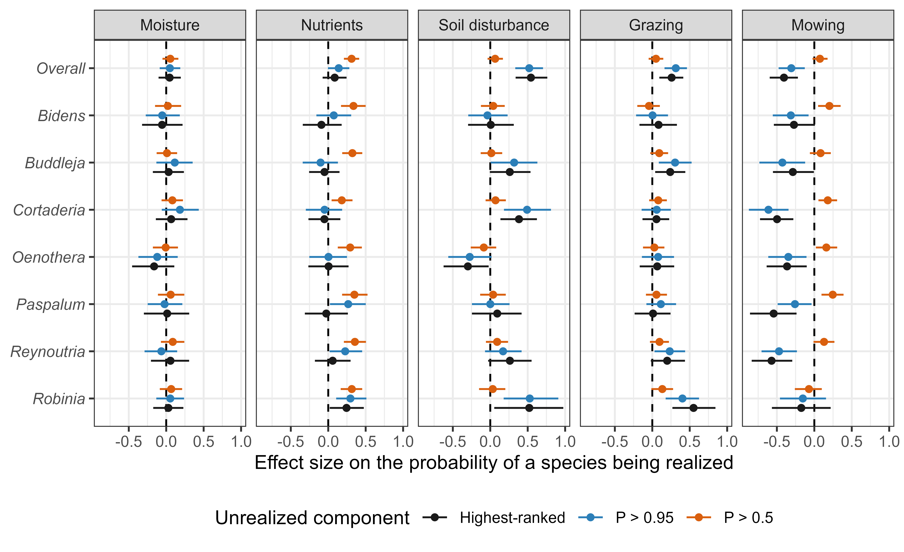
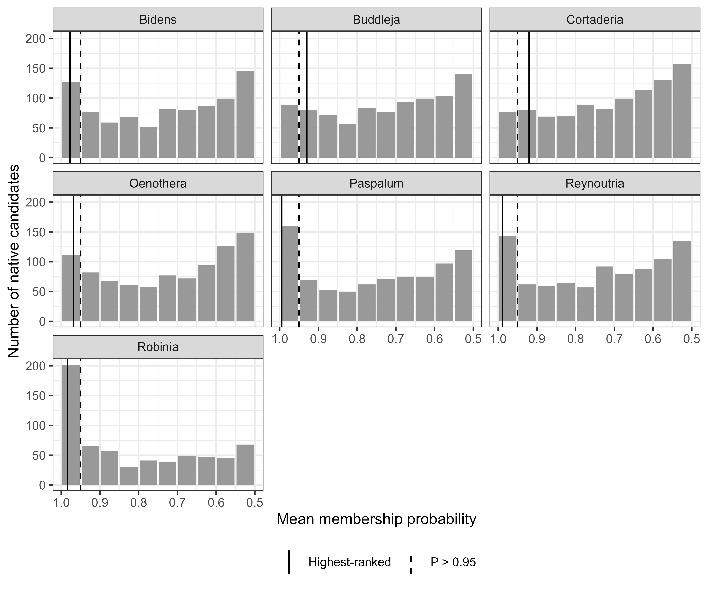
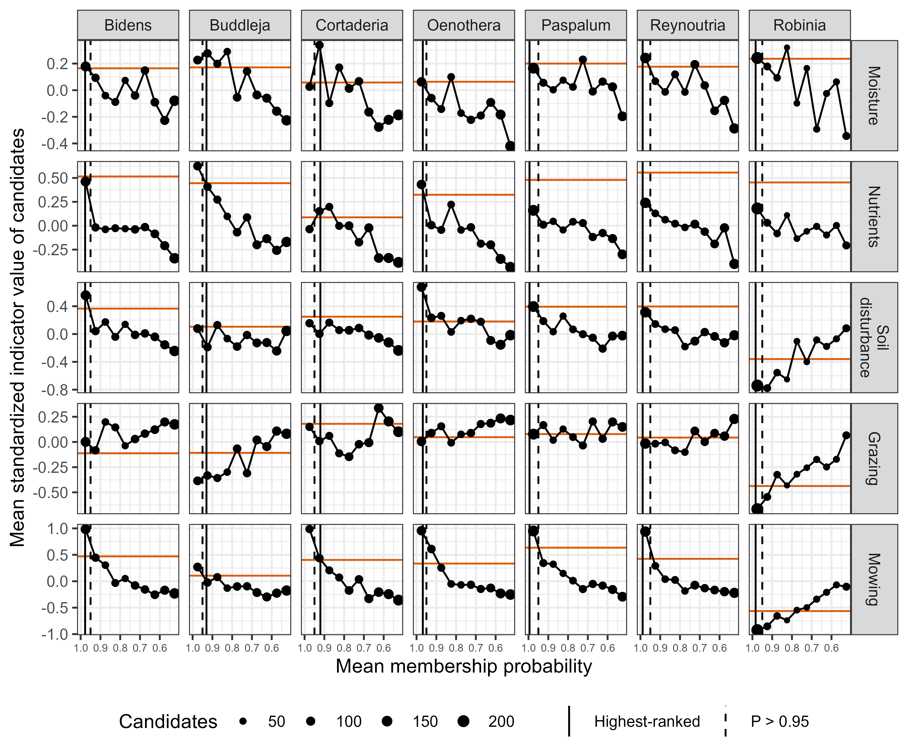

```{r setup, include=FALSE}
knitr::opts_chunk$set(echo = FALSE, message = FALSE, warning = FALSE)
library(tidyverse)
```

In the main analysis, the unrealized component of each study habitat comprised the native candidates with the highest membership probability, up to the number of realized species (highest-ranked). We refitted the same models with two alternative definitions: all native candidates with mean membership probability > 0.95, and all native candidates with mean membership probability > 0.5, the value corresponding to random co-occurrence in the hypergeometric method, following the principle of including only species that co-occur more often than expected at random (Paganeli et al., 2025). The three criteria are nested cuts of the same probability ranking (Table S5.1, Fig. S5.2). No significant effect changed sign between the highest-ranked and P > 0.95 criteria; six effects changed significance, five of them becoming significant (four with the same sign as the non-significant highest-ranked estimate, and nutrients in *Paspalum* swards, whose highest-ranked estimate was close to zero) and one (soil disturbance in *Oenothera* beds) losing significance (Fig. S5.1, Table S5.2). Under the P > 0.5 criterion, soil disturbance and grazing effects disappeared, mowing effects became positive in four models, and nutrient effects became positive in all models, as the unrealized component incorporated a large number of low-probability candidates with lower nutrient and moisture indicator values (Fig. S5.3). 

```{r tabS5sizes}
read.csv("S5-pool-sizes.csv", fileEncoding = "latin1", check.names = FALSE) %>%
  rename(`Study habitat` = habitat, Realized = realized,
         `Highest-ranked` = topn_unrealized, `P > 0.95` = p95_unrealized, `P > 0.5` = p05_unrealized) %>%
  knitr::kable(booktabs = TRUE,
               caption = "Number of native species in the realized component and in the unrealized component under each criterion. Overall: one row per species, as in the overall model.")
```

```{r figS5coef, out.width = "100%", fig.cap = "Effect sizes (posterior means and 95\\% credible intervals) under the three definitions of the unrealized component. Highest-ranked is the criterion used in the main text."}

```

```{r figS5counts, out.width = "100%", fig.cap = "Number of native candidates per bin of mean membership probability. Vertical lines show the lowest probability included by the highest-ranked (solid) and P > 0.95 (dashed) criteria; the P > 0.5 criterion includes all bins."}

```

```{r figS5traits, out.width = "100%", fig.cap = "Mean indicator values of native candidates per bin of mean membership probability (points sized by number of candidates), compared with the mean of the realized species (horizontal line). Values standardized across all species-type combinations in the P > 0.5 pool. Vertical lines as in Fig. S5.2."}

```

```{r tabS5coef}
read.csv("S5-coefficients.csv", fileEncoding = "latin1", check.names = FALSE) %>%
  mutate(across(-c(Model, criterion), ~ sub(" \\[.*\\]", "", .x))) %>%
  mutate(criterion = recode(criterion, "Top-N" = "Highest-ranked")) %>%
  rename(Criterion = criterion) %>%
  knitr::kable(booktabs = TRUE,
               caption = "Posterior means of the effects under each criterion. Asterisks mark 95\\% credible intervals that exclude zero (full intervals in Fig. S5.1).")
```
